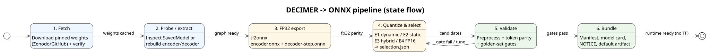

# decimer-onnx-toolchain

Reproducible pipeline to convert [DECIMER](https://github.com/Kohulan/DECIMER-Image_Transformer) models into **optimized ONNX** artifacts for fast, self-contained inference (no TensorFlow at runtime).

This toolchain works with **three distinct models** (different sources/weights, tokenizers and separate evaluation dossiers):
1. **`ocsr-printed`** — DECIMER v2 OCSR for printed structures (Zenodo 8300489)
2. **`ocsr-handdrawn`** — DECIMER v2 OCSR trained for hand-drawn structures (upstream “Hand-drawn specialist”, Zenodo 10781330; in our cross-eval it also performs competitively on printed, so not exclusive to hand-drawn)
3. **`image-classifier`** — DECIMER Image Classifier (Iagea/DECIMER-Image-Classifier)

> Status: bootstrap → consolidated. Fetch/export/quantization/benchmark/selection completed per dossier; selected artifacts staged in `chemistry-draw-ocsr/` (ignored, for HF/chemistry_draw). Some engineering/packaging items remain (see `TODO.md`).

## Pipeline



1. **Fetch** — download pinned model weights (Zenodo/GitHub raw, pinned checksums/commit) with verification.
2. **Probe/extract** — load the SavedModel or rebuild encoder/decoder from checkpoints.
3. **FP32 export** — export `encoder.onnx` + 1-step `decoder.onnx` (tf2onnx); greedy loop stays in Python.
4. **Quantize & select** — build candidates (E1 dynamic INT8, E2 static INT8, E3 hybrid, E4 FP16), measure token parity/latency/size, pick the best that passes gates.
5. **Validate** — preprocessing parity, token parity vs TensorFlow, golden-set chemistry checks.
6. **Bundle** — manifest, model card, NOTICE, `selection.json`, and a `default/` artifact.

See [`TODO.md`](TODO.md) for progress.

## Benchmark report

- [`docs/benchmark-spec.md`](docs/benchmark-spec.md): especificación general — **tres dossiers independientes** (impreso, manuscrito, clasificador), sin ranking entre modelos; fuentes por dossier, `n` por IDs congelados, 3 vistas dentro de dossier, 6670746 fuera de scope.
- Dossiers: [`docs/benchmark-dossier-printed.md`](docs/benchmark-dossier-printed.md) · [`docs/benchmark-dossier-handdrawn.md`](docs/benchmark-dossier-handdrawn.md) · [`docs/benchmark-dossier-classifier.md`](docs/benchmark-dossier-classifier.md)
- [`docs/benchmark-report.md`](docs/benchmark-report.md): informe neutral auto-generado (pendiente alinear a 3 secciones por dossier).
- Regenerar: `uv run decimer-export report`

## Quick start (bootstrap)

Requires [uv](https://docs.astral.sh/uv/) and Python 3.11.

```bash
uv sync --all-packages
uv run decimer-export models                        # list available model keys
uv run decimer-export fetch --model ocsr-printed    # DECIMER v2 (printed)
uv run decimer-export fetch --model ocsr-handdrawn  # hand-drawn specialist
uv run decimer-export fetch --model image-classifier
```

Downloaded weights are cached under `data/weights/`  and verified against pinned checksums.

## Models & sources

| Fetch key | What it is | Source | License / notes |
|---|---|---|---|
| `ocsr-printed` | DECIMER v2 printed OCSR (inference, `models.zip`) | [Zenodo 8300489 — DECIMER V2 Models](https://zenodo.org/records/8300489) | CC-BY-4.0 (Rajan et al.) |
| `ocsr-handdrawn` | DECIMER v2 OCSR trained for hand-drawn structures (upstream: Hand-drawn specialist) | [Zenodo 10781330 — DECIMER V2 Hand drawn Model](https://zenodo.org/records/10781330) | CC-BY-4.0 |
| `image-classifier` | DECIMER Image Classifier (EfficientNetB0, structure vs non-structure) | [Iagea/DECIMER-Image-Classifier](https://github.com/Iagea/DECIMER-Image-Classifier) (pinned commit) | MIT (upstream code); trained weights fetched from upstream repo at a pinned commit |


## Layout

```
packages/decimer-onnx/          # runtime (no TensorFlow) — scaffolded
packages/decimer-onnx-export/   # export/quantize toolchain — fetch implemented
configs/                        # model & quantization configs
docs/                           # pipeline, decisions (plan.md is local/gitignored)
data/                           # weights, calibration, validation (gitignored)
tests/ scripts/
```

## License & attribution

Code: **Apache-2.0** (see [`LICENSE`](LICENSE)). DECIMER OCSR weights: **CC-BY-4.0** (Zenodo [8300489](https://zenodo.org/records/8300489) printed, [10781330](https://zenodo.org/records/10781330) hand-drawn, Rajan et al.). DECIMER Image Classifier: upstream [Iagea/DECIMER-Image-Classifier](https://github.com/Iagea/DECIMER-Image-Classifier) (MIT code; trained weights fetched from the upstream repo at a pinned commit). Redistributed/quantized weights must keep required attribution; see `NOTICE` (to be added with first bundle).
